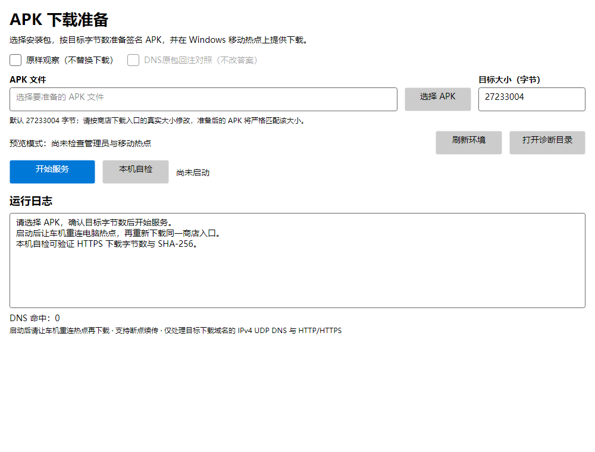

<div align="center">

# flymeauto-injector

**在 Windows 移动热点上，为 Flyme Auto 提供本地 APK 下载替换。**


原生桌面界面 · APK 精确大小与签名 · HTTPS 下载 · 断点续传 · 自动诊断

[GitHub 仓库](https://github.com/wobushiafa/flymeauto-injector) · [下载程序](https://github.com/wobushiafa/flymeauto-injector/releases/latest)

</div>



## 适用范围与风险声明

**仅在老款领克 07 / 08、车机版本 2.5.0 上测试有效。**
其他车型、年款及车机版本均未验证，不保证可用；请勿据此推断所有 Flyme Auto 车机均受支持。

**操作有风险，请自行决定是否使用，并自行承担全部后果。**
下载替换及安装第三方 APK 可能导致应用无法使用、数据丢失、车机异常，并可能影响保修或售后服务。
使用前请备份重要数据，仅在车辆安全停放时操作，勿在行驶中操作。

本工具按现状提供，不作任何明示或默示保证。在适用法律允许的最大范围内，作者及贡献者对使用本工具产生的任何直接或间接损失、故障及其他后果不承担任何责任。
**如不接受上述风险与免责条款，请勿下载或使用本工具。**

## 下载

打开 [Releases 下载页面](https://github.com/wobushiafa/flymeauto-injector/releases/latest)，下载最新的
`flymeauto-injector-<版本>-win-x64.zip`，完整解压后运行：

```text
flymeauto-injector.exe
```

**支持 Windows 10 / 11 x64。** 发布包自包含，无需另装 .NET、Python、Java 或 Android SDK。
请保留 EXE 同目录的 DLL、SYS 和许可证文件；不要单独移动 EXE。
请下载 Releases 中的程序压缩包，而非 **Source code** 源码包。

> 首次启动需要允许 Windows 管理员权限，用于热点数据包处理与本次服务的防火墙规则。
> 若系统应用程序控制策略拦截 EXE 或驱动，需要按本机管理要求放行；程序不会关闭系统安全策略。

## 开始前准备

- 一台能上网、支持 Windows 移动热点的电脑，建议通过 USB 手机共享或有线网络上网。
- 让车机通过 **Wi-Fi 连接电脑热点**，并先确认车机应用商店中的 **Bilibili（哔哩哔哩）**能正常下载。
- 准备你有权安装、实际想装到车机上的本地 APK。本教程通过车机应用商店的 **Bilibili 下载入口**触发替换，电脑端选择的是你自己的目标 APK。

默认 `27233004` 字节对应本次已验证的 **Bilibili 下载包大小**，**不适用于所有应用或后续更新版本**。
如果商店中的 Bilibili 已更新，请先确认其原始下载包的精确字节数，再填写目标大小。
选择的 APK 必须能装入这个目标大小。工具会重新签名，安装是否成功还取决于车机兼容性、签名冲突及安装策略。

## 操作教程

### 1. 开启电脑热点

进入 **设置 → 网络和 Internet → 移动热点**：

1. 选择实际可上网的连接作为共享来源，例如 USB 手机共享对应的以太网。
2. 通过 **Wi-Fi** 共享，建议先选择 **2.4 GHz**。
3. 开启热点，让车机连接该热点。
4. 打开车机应用商店，找到 **Bilibili（哔哩哔哩）**，点击下载，确认有正常进度，再取消这次下载。

### 2. 选择 APK 和目标大小

以管理员身份启动 `flymeauto-injector.exe`，点击 **选择 APK**，选择你实际想安装的本地 APK。
目标大小填写车机商店 **Bilibili 原始下载包**的精确字节数；已验证入口为默认值 `27233004` 字节。
点击 **刷新环境**，确认识别到热点名称和 IPv4 地址。

可以先点击 **本机自检**：它验证所选 APK 的本机 HTTPS 下载及 SHA-256，不代表已经替换车机下载或完成安装。

### 3. 开始替换

1. 保持“原样观察”未勾选，点击 **开始服务**。
2. 等待 APK 准备完成，以及日志出现 **下载转接就绪**、**服务已启动**。
3. 让车机断开并重新连接电脑热点，取消旧下载任务，再打开车机应用商店，点击 **Bilibili（哔哩哔哩）→ 下载**。
4. 观察程序日志：DNS 命中 → 下载连接转接 → TLS 成功 → HTTP 请求 → APK 发送进度。
5. 下载结束后在车机确认安装；打开应用，确认实际安装的是你在电脑端选择的目标 APK。

车机可能缓存 DNS 或保留旧下载连接，**开始服务后重新连接热点很重要**。
连接中断时支持 Range 断点续传；“已写入套接字”不等于车机安装完成。

### 4. 停止和恢复

点击 **停止服务**，或正常关闭窗口并等待清理完成。
程序释放下载监听、数据包转接句柄和本次临时防火墙规则，不修改系统路由。
之后车机重新创建下载任务即可使用原始下载链路。

## 常见问题

| 现象 | 处理方法 |
| --- | --- |
| 热点地址数为 0 | 确认 Windows 移动热点已开启并共享 IPv4，车机已连接，再刷新环境。不要使用 `169.254.*` 地址。 |
| 域名没有可用公网 IPv4 | 检查系统 DNS、代理或隧道；下载域名需要真实公网 IPv4，不能解析为私网或虚拟地址。 |
| 有 DNS 命中，下载仍是 0% | 确认有“下载连接转接”和“TCP到达”；重连热点、取消旧任务，核对目标入口与字节数。 |
| TLS 成功但安装失败 | 确认 APK 兼容车机，目标大小正确，并检查车机对新签名或同包名应用的限制。 |
| 抓包启动失败，提示已启动监视器 | 说明已有 PktMon 会话；程序不抢占其他抓包。查看后续下载服务日志。 |
| 不确定正常链路是否可用 | 停止替换，勾选“原样观察（不替换下载）”后重新测试。该模式无需 APK。 |

点击 **打开诊断目录** 查看完整日志。为兼容已有签名身份，数据目录沿用
`%LOCALAPPDATA%\FlymeNative\`：`logs\` 保存会话，`apk-signing.pfx` 保存本机 APK 签名身份。
签名文件不要公开或随意删除。自动抓包最长 60 秒，记录网络元数据；分享诊断包前请检查其中的个人信息。

